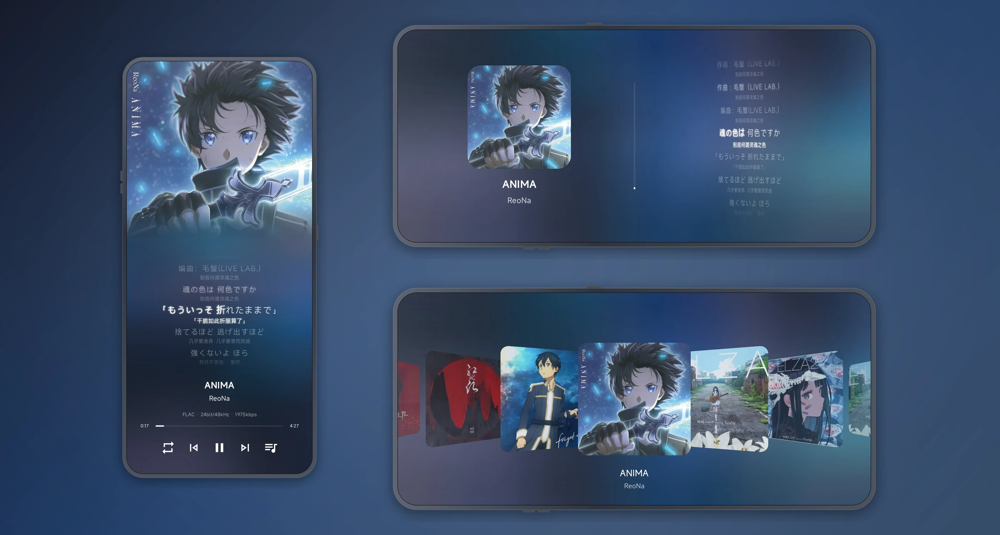
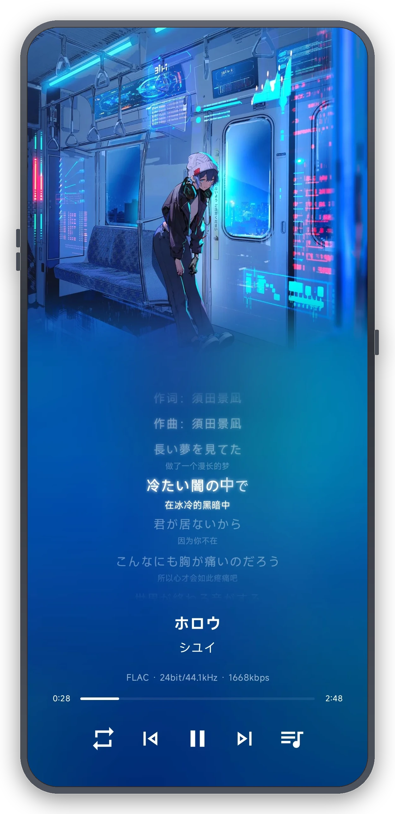
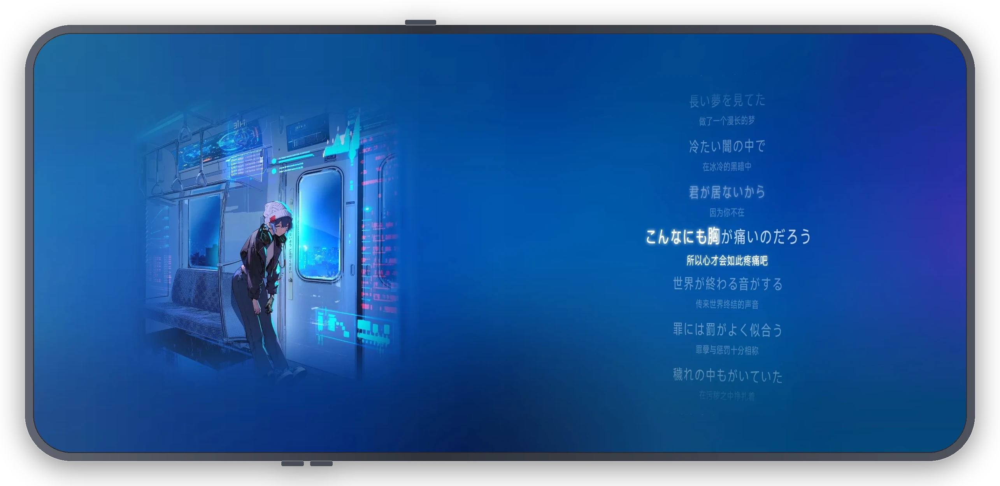
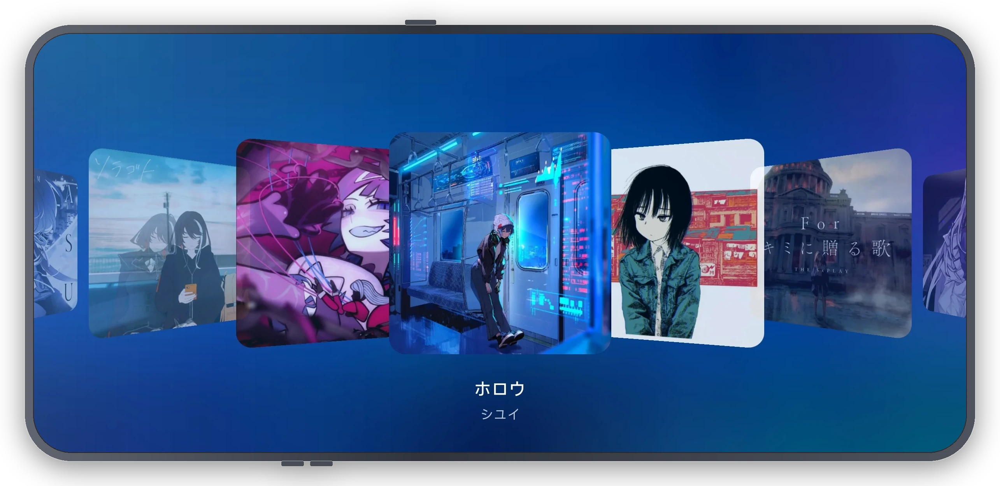

<div align="center">


# 忆潮音乐 · Echo Tide

**沉浸聆听，忠于原声**

[English](README.md) | **简体中文**




</div>

## 产品展示

无论横竖，只为沉浸。

| 竖屏播放器 | 横屏播放器 | 横屏 3D 封面轮播 |
| :---: | :---: | :---: |
|  |  |  |

> 截图为真机运行画面，曲目封面与歌词版权归原作者所有，仅作界面演示。

## 技术栈

| 层次 | 技术 |
| --- | --- |
| 语言 | Kotlin 2.4.21 |
| UI | Jetpack Compose(BOM 2026.09.00)+ Material 3 |
| 播放 | Media3 ExoPlayer 1.11.1 + MediaSessionService（USB 独占另走原生等时层） |
| 导航 | AndroidX Navigation3 1.2.0（类型安全路由） |
| 依赖注入 | 手动 DI（单例挂在 Application） |
| 持久化 | DataStore Preferences 1.2.1 |
| 图片加载 | Coil 3.6.3 |
| 网络 | OkHttp 5.5.0 |
| 序列化 | kotlinx.serialization 1.11.0 |
| 异步 | kotlinx.coroutines 1.11.0（含 coroutines-guava 桥接 MediaController Future） |
| 自适应布局 | androidx.window 1.5.1、material3-adaptive 1.3.0 |
| 生命周期 | androidx.lifecycle 2.11.0、activity-compose 1.13.0 |
| 原生层 | NDK 28.2.13676358、CMake 3.22.1（USB 独占的 usbfs 等时传输） |
| 构建 | AGP 9.4.1、Gradle 9.8.0、refreshVersions |

## 项目结构

```
.
├── app/
│   └── src/main/
│       ├── kotlin/com/yichao/evilgodxu/
│       │   ├── data/                    # 数据层
│       │   │   ├── cache/               #   缓存台账(分类登记表 / 逐类占用统计 / 冷启动回收)
│       │   │   ├── music/               #   音乐领域
│       │   │   │   ├── analysis/        #     无损容器、PCM 格式、FFT 与全曲频谱、容器头解析
│       │   │   │   ├── api/             #     歌曲 / 封面 / 歌词获取、歌词编解码(LRC / QRC / KRC / lrcx)、音质、翻译与网络客户端
│       │   │   │   ├── clip/            #     分享、默认铃声 / 闹钟设置、可读本地 URI、频谱图导出
│       │   │   │   ├── download/        #     曲目下载与缓存
│       │   │   │   ├── highlight/       #     副歌(高潮)定位(纯歌词分析)、全库片段表(后台扫描 + 落盘)
│       │   │   │   ├── metadata/        #     封面流水线与取色、元数据与歌词读写(区间流式标签读写)、内嵌标签补全、各级缓存
│       │   │   │   ├── model/           #     曲目与搜索数据模型(以平台键为身份)
│       │   │   │   ├── panel/           #     共享播放状态持有器、搜索逻辑与歌词翻译
│       │   │   │   ├── playback/        #     播放状态、队列切换、排序、常听、USB 直出 / 独占与免打扰、按设备音频输出(含缓冲策略)、输出延迟实测、音频信息快照(含蓝牙链路与编解码器解析)
│       │   │   │   ├── proxy/           #     代理音源(导入 / 解析 / 引擎 / 存储)与自定义平台注册表
│       │   │   │   ├── recommend/       #     歌词文本特征(与副歌定位共用)
│       │   │   │   ├── MusicScanner.kt  #     MediaStore 扫描与曲目补全
│       │   │   │   └── PlaylistRefresher.kt  # 播放列表刷新流程
│       │   │   ├── persistence/         #   持久化落点声明与共享路径(磁盘文件名的唯一事实来源)
│       │   │   ├── playlist/            #   歌单存储(智能 / 自定义)、分组与歌手页曲序
│       │   │   ├── repository/          #   设置仓库
│       │   │   └── settings/            #   设置 DataStore、播放与歌词排版偏好、启动语言镜像
│       │   ├── floatingwindow/          # 迷你播放器悬浮窗管理与控制器
│       │   │   └── miniplayer/          #   迷你播放器浮层 / 紧凑条 / 展开式播放列表
│       │   ├── localization/            # 应用内多语言管理
│       │   ├── log/                     # CrashLogManager
│       │   ├── navigation/              # Navigation3 类型安全路由与导航宿主
│       │   ├── permission/              # 权限、悬浮窗授权、电池优化白名单与前台状态监控
│       │   ├── screens/                 # 页面(首页 / 设置 / 存储 / 排版 / 频谱 / 元数据)
│       │   │   ├── home/                #   首页播放器 + 权限流程 + 歌单(含歌手页) + 在线搜索
│       │   │   │   ├── compact/         #     竖屏组装器(compact/player:竖屏播放器)
│       │   │   │   ├── expanded/        #     横屏组装器(expanded/player:横屏播放器)
│       │   │   │   └── component/       #     analysis / audioinfo / bar / dialog / panel / permission / player / playlist(含 playlist/expanded)/ queue / search / shell / swipe
│       │   │   ├── settings/            #   外观 / 存储 / 语言 / 播放 / 代理音源 / 关于
│       │   │   │   └── component/       #     appearance / cache / dialog / entry / info / language / playback / proxy
│       │   │   ├── cache/               #   存储 / 缓存管理(compact / expanded / component)
│       │   │   ├── spectrum/            #   频谱分析页(compact / expanded / component)
│       │   │   ├── typography/          #   歌词排版设置(compact / expanded / component)
│       │   │   └── metadata/            #   元数据编辑页(compact / expanded / component)
│       │   ├── service/                 # MediaSessionService 播放引擎
│       │   ├── theme/                   # Material 3 配色与字体
│       │   ├── ui/                      # 全局共享 UI:封面渐隐 / 过渡 / 预取 / 流动帧存储,对话框与选择器骨架,播放器与分区部件,图标
│       │   ├── update/                  # 检查更新、应用内更新与 APK 校验
│       │   ├── utils/                   # 通用工具
│       │   ├── windowsize/              # 窗口尺寸类与横屏形态判定
│       │   ├── App.kt                   # Application 入口(持有单例与组合局部)
│       │   ├── AppContent.kt            # 根可组合项(导航宿主与全局弹窗)
│       │   ├── MainActivity.kt          # 唯一 Activity(系统栏、外部意图、启动语言)
│       │   └── MainViewModel.kt         # Activity 专属 ViewModel(含 AppUiState)
│       ├── cpp/                         # 原生层:USB 独占的 usbfs 等时传输(JNI 桥 + 等时流)
│       └── res/                         # 资源(values / values-en)
├── baselineprofile/                     # 基准配置与启动配置源集
├── gradle/
│   ├── libs.versions.toml               # 版本目录(依赖管理)
│   └── wrapper/
├── docs/                                # 代理音源规范、界面截图、注意事项与 APK 报告
├── LICENSE
├── build.gradle.kts
├── settings.gradle.kts
└── gradle.properties
```

自定义代理音源的接口规范见 [忆潮代理音源规范](docs/忆潮代理音源规范.md)。

## 权限

| 权限 | 用途 |
| --- | --- |
| 悬浮窗 | 后台播放时的迷你播放器，及其展开的播放列表 |
| 全部文件访问 | 导入与管理本地音乐文件 |
| 音乐访问(`READ_MEDIA_AUDIO`) | 读取设备曲库并播放 |
| 图片(`READ_MEDIA_IMAGES`、`READ_MEDIA_VISUAL_USER_SELECTED`) | 内嵌封面与本地封面候选；Android 14「选中的照片」部分授权同样视为已授权 |
| 蓝牙(`BLUETOOTH_CONNECT`) | 读取当前蓝牙输出设备的名称、地址与协商出的编解码器（音频信息） |
| 前台服务(`mediaPlayback`、`FOREGROUND_SERVICE_MEDIA_PLAYBACK`) | 后台播放 + 通知栏 / 锁屏控制 |
| 通知(`POST_NOTIFICATIONS`) | 版本更新下载完成通知(Android 13+) |
| 网络(`INTERNET`、`ACCESS_NETWORK_STATE`) | 在线搜索、歌词与封面获取、检查更新 |
| 音频设置(`MODIFY_AUDIO_SETTINGS`) | 播放引擎的音频配置，含 USB 直出按设备声明申请动态混音器属性所需 |
| 免打扰(`ACCESS_NOTIFICATION_POLICY`) | USB 直出期间自动切至「仅闹钟」档位，屏蔽通知与铃声干扰（不压制媒体流） |
| 唤醒锁(`WAKE_LOCK`) | 熄屏后维持播放引擎运行 |
| 忽略电池优化(`REQUEST_IGNORE_BATTERY_OPTIMIZATIONS`) | 避免后台播放被系统回收 |
| 安装应用(`REQUEST_INSTALL_PACKAGES`) | 应用内更新时拉起系统安装器 |
| 修改系统设置(`WRITE_SETTINGS`) | 将曲目设为默认来电铃声 / 闹钟铃声 |

权限由引导对话框逐项申请：三项曲库权限为必需，通知与电池优化白名单为可选且仅在缺失时列出。Android 14 的「选中的照片」部分授权与完整图片权限同等看待——查询仍能返回用户已选中的图片，足以挑选封面。蓝牙权限不列入引导流程：它只在音频信息面板读到当前输出为蓝牙设备时就地申请，不用该面板便不会被要求授权。

## 快速开始

### 环境要求

- JDK 21 - 25
- Android Studio（建议最新稳定版）
- 包含 API 37(`compileSdk`)的 Android SDK

### 构建

```bash
git clone https://github.com/Evilgodxu/EchoTide-Music.git
cd EchoTide-Music

# 调试包
./gradlew assembleDebug

# 发布包（需先配置签名，见下文）
./gradlew assembleRelease
```

APK 输出为 `app/build/outputs/apk/` 下的 `EchoTideMusic-<版本号>-arm64-v8a.apk`，仅构建 `arm64-v8a` ABI。

### 发布签名

Release 构建从项目根目录的 `local.properties` 读取签名凭据：

```properties
KEYSTORE_PASSWORD=你的签名库密码
KEY_ALIAS=你的签名别名
KEY_PASSWORD=你的别名密码
```

签名库文件默认位于项目根目录 `jh.keystore`（如需调整请修改 `app/build.gradle.kts` 中的 `storeFile`）。两个文件均已被 git 忽略，请勿提交。

## 免责声明

忆潮音乐是一款面向本地曲库的播放器，代理音源仅用于声明个人网络接口配置，不提供基于运行时的破解服务。

## 致谢

- 网易云音乐搜索服务曾参考 [Qplayer](https://github.com/TIMER-err/qplayer)
- 列表拖拽排序参考 [Reorderable](https://github.com/Calvin-LL/Reorderable) 等价实现，未采用依赖方式
- 基于 [musicdl](https://github.com/CharlesPikachu/musicdl) 实现网易云音乐、酷狗、酷我、QQ 的 Kotlin 原生搜索服务

## License

[AGPL-3.0](LICENSE) © 2026 Evilgodxu
